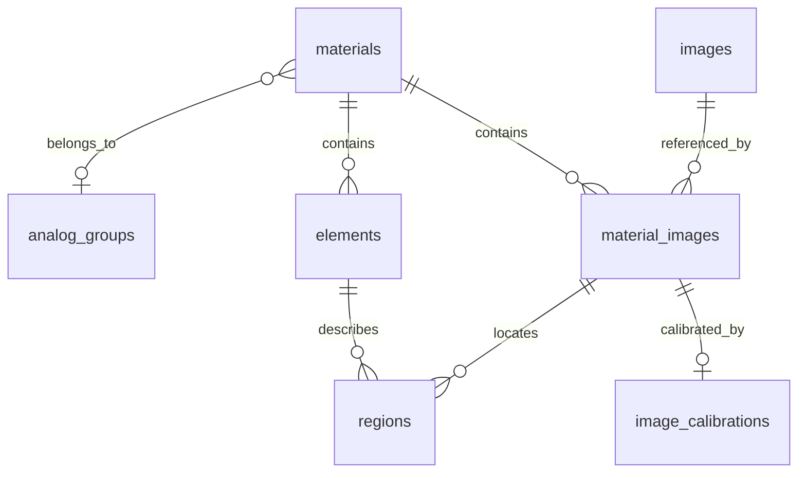

# Модель данных HISTOSETS — схема 6 (update7.1)

SQLite используется в настольном приложении. Будущий PostgreSQL должен сохранять **те же сущности, имена полей, UUID и связи**. Физический SQL и механизм миграций будут отдельными. Сервер PostgreSQL пока не реализован; update6 объединяет локальные каталоги через проверяемые пакеты обмена.

Схема: [`001_initial.sql`](../src/HistOSets.Storage/Migrations/001_initial.sql), [`002_catalog_foundation.sql`](../src/HistOSets.Storage/Migrations/002_catalog_foundation.sql), [`003_editor_geometry.sql`](../src/HistOSets.Storage/Migrations/003_editor_geometry.sql) [`004_compound_geometry.sql`](../src/HistOSets.Storage/Migrations/004_compound_geometry.sql) [`005_catalog_exchange.sql`](../src/HistOSets.Storage/Migrations/005_catalog_exchange.sql) и [`006_training_preparation.sql`](../src/HistOSets.Storage/Migrations/006_training_preparation.sql). Доступ к данным находится в `HistOSets.Storage`, независимо от WPF; модели `AtlasCatalog` служат проекцией для просмотра. В схеме 6 — 21 таблица. Геометрия областей хранится в `regions`, физический масштаб — в `image_calibrations`; отдельные таблицы измеренных площадей и периметров не нужны, поскольку они вычисляются из этих исходных данных.

## Сущности

| Таблица | Назначение |
|---|---|
| `materials` | Материал любого типа: препарат, анатомическое изображение, рентгенограмма, схема. Авторство и права — свободные поля; неизвестные сведения не выдумываются. |
| `analog_groups`, `analog_group_translations` | Группа аналогичных материалов и её имена RU/EN. Материал входит максимум в одну группу; каждый материал сохраняет собственные UUID, изображения, описания и области. |
| `material_translations` | Название, краткое и полное описание на конкретном языке; уникальная пара материал–язык. |
| `images` | Неизменяемый оригинал: SHA-256, относительный ключ файла, размер в байтах и пикселях, DPI, MIME, ориентация. |
| `material_images` | Связь материала с несколькими изображениями и их порядок. Один оригинал может использоваться в нескольких материалах. |
| `image_calibrations` | Физический размер пикселя по X/Y и источник калибровки для конкретной связи материал–изображение. Редактор принимает известную физическую ширину и высоту оригинала и вычисляет масштаб каждой оси. |
| `elements` | Смысловой элемент материала, независимый от языка и конкретной области. |
| `element_translations` | Название и два описания элемента на конкретном языке. |
| `regions` | Область элемента на одном изображении материала. `geometry_type` — `polygon`, `rectangle`, `ellipse` или `compound`; `geometry_json` — её точное описание. Несколько областей могут принадлежать одному элементу. Составные внешние ключи запрещают связать элемент и изображение разных материалов. |
| `tag_groups`, `tag_group_translations` | Системные типы тегов и их названия RU/EN; сохранённые пользовательские группы схемы 1. |
| `tags`, `tag_translations`, `material_tags` | Теги и их связи с материалами. Интерфейс заполнения и фильтрации реализован в update4. |
| `import_batches` | Происхождение: исходный XML, SHA-256 XML и набора XML+изображения, применённая карта переводов, время импорта. |
| `training_prompts`, `training_prompt_translations` | Отдельные учебные описания объектов и элементов: несколько вариантов, включение/отключение, порядок и переводы. |
| `exchange_baselines` | Последнее принятое содержимое источника и локальный результат обмена для одного UUID; основа трёхстороннего сравнения. |
| `catalog_metadata`, `schema_migrations` | UUID, имя каталога, версия формата, время изменения и ревизия содержимого; журнал применённых миграций. |

Таблицы содержания и связей имеют `id`, `revision`, `created_utc`, `modified_utc`, `deleted_utc`, `origin_catalog_id`, `source_batch_id`. Для перевода и связи используется собственный UUID. Вершины входят в JSON своей области, а её UUID и ревизия хранятся в строке `regions`.

`deleted_utc` задаёт мягкое удаление; удалённые записи не показываются, но входят в резервную копию и могут быть явно выбраны для обмена. `revision` защищает редактор от устаревшего сохранения. При обмене сравнивается содержимое, поскольку независимо изменённые копии могут иметь одинаковую ревизию. Совпадение UUID не разрешает автоматическую перезапись.

## Новые реквизиты схемы 2

| Таблица | Реквизиты и ограничения |
|---|---|
| `catalog_metadata` | `name` — имя базы; `modified_utc` — время изменения; `content_revision` — счётчик сохранённых изменений. В текущей схеме `format_version = 6`. Чтение, поиск и переключение языка не меняют эти значения. |
| `materials` | `status` — `draft` или `ready`; `analog_group_id` — необязательная ссылка на группу аналогов. |
| `analog_groups` | UUID и общие поля ревизии/происхождения. Название не служит идентификатором. |
| `analog_group_translations` | `group_id`, `locale`, `name`; одна запись на группу и язык. Создание и изменение через API требуют обоих имён RU/EN. |
| `material_images` | `is_primary` — основное изображение. Частичный уникальный индекс допускает максимум одну активную основную связь на материал. Для `ready` нужна ровно одна. |
| `tag_groups` | `is_system` защищает предопределённые типы. Стабильный `code`: `author`, `organization`, `subject`, `topic`, `purpose`, `other`. |
| `image_calibrations` | `material_image_id`; `pixel_size_x_m`, `pixel_size_y_m` — **метры на пиксель**, обе величины положительны; `source_kind` — `manual_dimensions`, `image_metadata` или `scale_bar`; `source_note` — пояснение. Необязательные `input_width`, `input_height`, `input_unit` сохраняют исходный ввод целиком; единица `m`, `cm`, `mm`, `um` или `nm`. Одна активная калибровка на связь. |

Калибровка не выводится из DPI: DPI исходного файла нужен для переноса старых WPF-координат и сам по себе не задаёт размер биологического объекта. Ввод калибровки, её изменение и удаление входят в рабочую копию изображения и сохраняются одной транзакцией с геометрией. Измерения пересчитываются при изменении любой из этих величин; исходные координаты не меняются.



Связь группы аналогов с материалом необязательна. Диаграмма показывает пространственную часть модели; переводы и теги описаны в таблицах выше.

## Готовность материала

`ready` означает: есть основное изображение; заполнены название, краткое и полное описание материала и каждого его элемента на RU/EN; у назначенных тегов и их типов, а также у группы аналогов есть оба названия. Проверка готовности и сохранение в состоянии `ready` дополнительно проверяют наличие, размер и SHA-256 связанных файлов изображений.

Миграция из схемы 1 и импорт вычисляют начальный статус после проверки файлов. Неполные исходные материалы остаются `draft`, сохраняют прежние тексты, языки `und` и области. При изменении справочников и назначений через API готовый материал, потерявший обязательные сведения, становится черновиком в той же транзакции. Исправление сведений само по себе не возвращает `ready`. Редактор позволяет явно сохранить черновик или готовый объект. Список редактирования показывает также незаполненные карточки без изображения; обычному просмотру требуется доступное изображение.

## Геометрия и сохранение в update5.3

У каждой области собственная строка `regions` и собственный JSON. Карточка, элементы, переводы, назначения и области сохраняются одной транзакцией. Отдельных JSON-файлов с путями из базы нет: это исключает ситуацию, когда SQLite обновлён, а файл геометрии остался старым.

```json
{"version":1,"kind":"ellipse","coordinateSpace":"pixels","x":120.5,"y":80,"width":60,"height":35}
```

Для прямоугольника используются те же четыре параметра и `kind: "rectangle"`. Для полигона вместо границ задаётся упорядоченный массив `points: [[x, y], ...]`. Замыкающая сторона подразумевается; повторные вершины старой разметки не удаляются. Числа сохраняются с точностью `double`, без округления до экранных пикселей. Нетронутый эллипс остаётся параметрической фигурой и не заменяется многоугольником при сохранении. При изменении кистью или ластиком фигура становится составной полигональной областью. Простое открытие, измерение и миграция не выполняют это преобразование.

Составная область содержит кольца и правило заполнения `evenOdd`. При пересечении каждой границы принадлежность точке области меняется: внешняя область, отверстие, остров внутри отверстия. Раздельные фрагменты могут принадлежать одному UUID области.

```json
{"version":2,"kind":"compound","coordinateSpace":"pixels","fillRule":"evenOdd","rings":[[[0,0],[100,0],[100,100],[0,100]],[[30,30],[70,30],[70,70],[30,70]]]}
```

Кисть и ластик вычисляют объединение или разность выбранной области со следом круглой кисти. Сохраняется итоговая геометрия, а не история движений мыши. Повторное открытие не требует воспроизводить штрихи. Версия 1 остаётся форматом прежних примитивов, версия 2 используется для `compound`.

`RegionGeometryCodec` проверяет версию, тип, систему координат, конечность чисел и структуру JSON. Прямоугольник и эллипс требуют положительные размеры; полигон — минимум три различные вершины. Неизвестная версия или повреждённая геометрия отклоняется. Тип JSON должен совпадать с `regions.geometry_type`.

`MaterialDraft` — рабочая копия в памяти, а не отдельная таблица. До команды сохранения изменение текстов, назначений, изображений, калибровки и контуров не меняет объект в базе. Проверка исходной `materials.revision` предотвращает перезапись более свежей версии. Удаление использует `deleted_utc`; общий файл изображения не удаляется вместе с одной карточкой. Undo/Redo относится к текущей сессии редактора и не заменяет историю версий базы.

| Версия | Значение в update7.1 |
|---|---|
| Приложение | `0.7.1` |
| Схема SQLite | `6` |
| Формат геометрии внутри JSON | `1` — примитивы; `2` — составные области |
| Формат манифеста архива `.histosets` | `1` |
| Формат пакета `.histosets-exchange` | `2`; чтение прежнего `1` поддерживается |

## Типы SQLite и PostgreSQL

| Значение | SQLite сейчас | PostgreSQL в будущем |
|---|---|---|
| UUID | `TEXT`, каноническая форма `xxxxxxxx-xxxx-xxxx-xxxx-xxxxxxxxxxxx` | `uuid` |
| Названия, тексты, язык, ключ файла | `TEXT` | `text` |
| Время | `TEXT`, ISO 8601 с UTC-смещением | `timestamptz` |
| Счётчики, версии, размеры в байтах | `INTEGER` | `bigint` |
| Координаты и DPI | `REAL` (IEEE 754, 64 бит) | `double precision` |
| Отсутствующее значение | `NULL` | `NULL` |

SQLite работает с `STRICT`-таблицами и включёнными внешними ключами на каждом соединении. Идентификаторы не зависят от названия препарата. Имена таблиц и ограничения не требуют SQLite-специфического `AUTOINCREMENT`, локальных числовых ключей или двоичного хранения изображений.

UUID исходного импорта воспроизводимы (UUIDv5 с фиксированным пространством имён и ключом снимка). UUID изображения зависит от SHA-256 его байтов. Общий UUID двух независимо импортированных снимков не означает, что возможные последующие изменения не нужно сравнивать. Новые сущности редактора получают собственные UUID.

## Изображения и координаты

В `SPECIMENS/<sha256>.<extension>` лежат неизменённые оригинальные байты. В базе нет абсолютных путей. Каталог можно перемещать целиком, а ключи позже сопоставить с объектным хранилищем веб-версии. Производные пирамиды для сверхбольших сканов отложены до получения реального материала после 1.0 и не заменят оригинал.

Области хранятся в пикселях оригинала с ориентацией 1. Импорт файлов с иной EXIF-ориентацией, анимацией или несколькими страницами пока отклоняется: молчаливый поворот сделал бы старые контуры неверными. Масштабирование окна не изменяет координаты в базе.

Старые координаты WPF переводятся по каждой оси: `pixel = DIP × DPI / 96`. Недопустимый DPI интерпретируется как 96 в соответствии с update1. `COORDINATES="pixels"` в XML отменяет такое преобразование. Роговица большого увеличения имеет DPI 2400 и коэффициент 25. Преобразование выполняется **только при импорте**. Исходные выходы за границы изображения и повторные вершины не исправляются автоматически.

## Проверенное сопоставление переводов

Для принятого XML используется [`baseline-map.json`](../src/HistOSets.Storage/baseline-map.json), привязанный к SHA-256 исходного файла. Индексы начинаются с нуля.

| Материал | EN | RU | Общих элементов | Общих контуров |
|---|---:|---:|---:|---:|
| Роговица, малое увеличение | 0 | 7 | 3 | 3 |
| Роговица, большое увеличение | 1 | 6 | 5 | 4 |
| Кожа пальца | 2 | 5 | 10 | 16 |
| Мочевой пузырь | 3 | 9 | 5 | 6 |
| Трахея | 4 | 8 | 4 | 4 |
| **Всего** | | | **27** | **33** |

Перед объединением проверяются изображение, система координат, число элементов и точное равенство всех вершин у соответствующих элементов. Переводы без контуров сопоставлены явно в этой карте. Клиническая/морфологическая терминология не редактируется.

Незнакомый или изменённый XML импортируется без предположений о переводах: одна исходная запись — один материал, язык `und` (не определён). Совпадение названий, номера или геометрии само по себе не объединяет материалы. Для нового набора проверенная карта переводов должна быть подготовлена отдельно.

## Миграции и совместимость

Новая база создаётся сразу со схемой 6: все миграции, метаданные, `application_id` и `user_version` устанавливаются одной транзакцией во временной базе. Затем файл устанавливается как `catalog.sqlite`. Повторное открытие не применяет миграцию ещё раз. Непустая папка без базы, чужая БД, более новая или неизвестная версия отклоняются, а не пересоздаются.

Перед обновлением схемы 1–5 приложение создаёт полную копию `BACKUPS/before-schema6-<время>-<UUID>.histosets` внутри каталога. Отсутствующее или изменённое изображение блокирует копирование и миграцию. Все необходимые переходы 1 → 2 → 3 → 4 → 5 → 6 выполняются в одной транзакции; каталог схемы 5 проходит только переход 5 → 6. В переходе 1 → 2 имя базы берётся из имени папки, первое активное изображение становится основным, создаются системные типы тегов. Совпадение названий не объединяет материалы.

Переход 2 → 3 читает вершины каждого полигона по `ordinal`, сериализует их без изменения значений, переносит UUID, связи, ревизии, временные метки и происхождение области, затем удаляет старую таблицу точек. Проверка целостности выполняется до фиксации транзакции. Названия, тексты, изображения, теги, аналоги, калибровки и статусы схемы 2 сохраняются.

Переход 3 → 4 расширяет разрешённые типы геометрии значением `compound` и не переписывает исходный JSON, UUID, ревизии или калибровки старых областей. Новых таблиц нет.

Переход 4 → 5 добавляет только журнал сравнения `exchange_baselines` и обновляет версию схемы. Геометрия, изображения, калибровка и UUID сохраняются.

Переход 5 → 6 добавляет `training_prompts` и `training_prompt_translations`. Учебные описания из обычных текстов автоматически не создаются. Все прежние UUID, геометрия, калибровки и история обмена сохраняются.

Резервные копии схем 1–6 поддерживаются: восстановленная старая база обновляется при следующем открытии в update7.1. Предыдущая сборка не откроет схему 6; для возврата следует восстановить копию до миграции в отдельную папку и использовать соответствующую старую сборку. Старый XML импортируется отдельно, как прежде.

Один экземпляр HISTOSETS удерживает блокировку каталога. Соединения SQLite короткие, без пула; запись импорта — одна транзакция. После неудачного импорта могут остаться ни на что не ссылающиеся неизменяемые файлы; их повторное использование безопасно, они не показываются и не входят в копию. Автоматического удаления файлов нет.

## Резервная копия

Файл `.histosets` — ZIP с `manifest.json`, согласованным снимком `catalog.sqlite` (SQLite Backup API), всеми указанными в базе изображениями и исходными XML из `SOURCES`. Путь, длина и SHA-256 каждого файла проверяются при записи и восстановлении. Не хватает изображения — полная копия не создаётся.

Восстановление выполняется в новую/пустую папку через временный соседний каталог; готовая папка появляется только после проверки всей копии, версии SQLite, внешних ключей, UUID и контуров. Чужие пути, повторяющиеся имена и несовпадение файлов с БД отклоняются. Текущий каталог не заменяется. Ограничения формата update2: 100 000 файлов, 64 ГиБ распакованных данных, манифест до 16 МиБ. Их нужно пересмотреть при внедрении крупных сканов после 1.0.

SHA-256 обнаруживает повреждение и несогласованность содержимого; это не цифровая подпись автора. Пакет резервной копии восстанавливает один каталог; для объединения используется отдельный формат обмена update6.

## Обмен: новая таблица схемы 5

`exchange_baselines` содержит последнюю принятую пару отпечатков. Это не полная история версий и не копия геометрии. Сохранение отличающейся локальной версии или пропуск не обновляют эту основу сравнения. Импорт полностью совпадающих данных не создаёт историю сам по себе; равные записи могут быть учтены вместе с применением других изменений пакета.

| Поле | Значение |
|---|---|
| `source_catalog_id` | UUID каталога, из которого поступил пакет. |
| `entity_kind` | `material`, `tag`, `tag_group` или `analog_group`. |
| `entity_id` | UUID карточки или записи справочника. Вместе с двумя предыдущими полями образует первичный ключ. |
| `source_fingerprint` | SHA-256 логического содержимого, полученного из источника. |
| `local_fingerprint` | SHA-256 локального содержимого после принятого решения. |
| `source_revision` | Последняя принятая ревизия источника. Отличающееся содержимое с меньшей или равной ревизией требует решения; больший счётчик сам по себе не определяет победившую версию. |
| `acknowledged_utc` | Время принятого решения. |

Отпечаток карточки включает её дочерние записи, тексты, геометрию, калибровки и связи. Служебные времена, происхождение и счётчики ревизий исключены; изображение сопоставляется по SHA-256 оригинала. Это позволяет повторно использовать одинаковые байты с другим UUID изображения и сохранить идемпотентность импорта.

Если история есть, неизменённая локальная запись и изменённый источник дают предлагаемое обновление; локальные правки при прежнем источнике сохраняются. Различные правки с обеих сторон дают конфликт. Без истории два разных содержимых одного UUID тоже дают конфликт. Удаление рассматривается явно. Для общих справочников решение принимается отдельно с учётом других использующих их карточек.

`.histosets-exchange` содержит манифест, JSON со строками 17 таблиц содержания и только необходимые оригиналы изображений. Все шесть системных типов тегов включаются всегда, остальные справочники — по зависимостям выбранных карточек. UUID и отметки удаления передаются; `source_batch_id` не переносится, поскольку исходный XML мог содержать не выбранные карточки. У новых строк он равен `NULL`, а у существующих сохраняются локальные `source_batch_id`, `created_utc` и `origin_catalog_id`. Метаданные целевого каталога, журнал миграций и `exchange_baselines` не заменяются содержимым пакета. В формате 2 включены учебные описания всех выбранных объектов и их элементов. Прежний формат 1 не содержит этих таблиц; при его применении учебные описания сохранившихся владельцев остаются в целевой базе. Удаление карточки или элемента удаляет также его учебные описания. SQL из пакета не выполняется: допускаются только известные таблицы, поля и типы данных. Размеры, SHA-256, относительные пути, UUID, связи, геометрия и согласованность калибровки проверяются до предварительного просмотра.

Для существующего перевода того же владельца и языка или существующей связи материал–изображение/тег сохраняется локальный UUID строки. Оригинал с тем же SHA-256 также переиспользует локальный UUID изображения. Входящие ссылки переназначаются в той же транзакции. UUID самих карточек и элементов не объединяются по названиям.

Применение проверяет, что каталог не изменился после предварительного просмотра, и повторно проверяет подготовленные изображения. Перед изменением создаётся полный архив `BACKUPS/before-exchange-…histosets`; запись выполняется одной транзакцией. Отмена предварительного просмотра ничего не сохраняет. Отсутствие карточки в частичном пакете не означает её удаление. [Пользовательская инструкция](update6.md).

## Учебные описания: новые таблицы схемы 6

Учебное описание — отдельный вариант задания, а не копия краткого описания. У карточки и у каждого элемента может быть несколько вариантов. Они сохраняются одной транзакцией с рабочей копией карточки и передаются вместе с ней в формате обмена 2.

| Таблица | Поле | Назначение |
|---|---|---|
| `training_prompts` | `id` | UUID варианта. |
| | `material_id` | Обязательный UUID карточки-владельца. |
| | `element_id` | UUID элемента либо `NULL` для описания всей карточки. Составной внешний ключ запрещает элемент другой карточки. |
| | `sort_order` | Порядок вариантов у владельца, целое число от нуля. |
| | `is_enabled` | Включение варианта в подготовку самопроверки: 0 или 1. |
| `training_prompt_translations` | `id` | UUID перевода. |
| | `prompt_id` | Ссылка на вариант. |
| | `locale` | Язык; пара вариант–язык уникальна. |
| | `text` | Специальный учебный текст. |

Обе таблицы имеют стандартные `revision`, `created_utc`, `modified_utc`, `deleted_utc`, `origin_catalog_id` и `source_batch_id`. Удаление владельца мягко удаляет его варианты и переводы; UUID нельзя переназначить другому владельцу. Пустой либо отключённый вариант может сохраняться как подготовительная работа. Пригодность проверяется для выбранного языка и метода. Обычная проверка статуса `ready` не требует учебных описаний.

`TrainingCatalog` — неизменяемый снимок в памяти, а `TrainingPlan` — план занятия в памяти. Отдельных таблиц занятий, ответов, оценок и попыток в update7.1 нет. Снимок содержит контрольный отпечаток фактических данных и состояния оригиналов, чтобы не использовать устаревший план. Подготовка не изменяет каталог. [Инструкция](update7.1.md).

## Источники технических решений

- [Microsoft.Data.Sqlite: транзакции](https://learn.microsoft.com/en-us/dotnet/standard/data/sqlite/transactions)
- [Microsoft.Data.Sqlite: BackupDatabase](https://learn.microsoft.com/en-us/dotnet/standard/data/sqlite/backup)
- [SQLite: внешние ключи](https://www.sqlite.org/foreignkeys.html)
- [SQLite: STRICT tables](https://www.sqlite.org/stricttables.html)
- [RFC 9562: UUIDv5](https://www.rfc-editor.org/rfc/rfc9562.html#name-uuid-version-5)

## Теги в update5.1 и совместимость с update4

`CatalogTags.cs` читает словарь и транзакционно изменяет теги, переводы и `material_tags`. Системные типы задаются миграцией: автор, организация, предмет, тема, назначение, прочее. Пользователь создаёт значения в существующих типах; системный тип нельзя переименовать или удалить. Идентификаторы пользовательских записей — случайные UUID; `code` не меняется при переименовании.

Пустое поле RU/EN при правке удаляет только этот перевод (с отметкой `deleted_utc`); требуется хотя бы одно имя. Остальные языки не перезаписываются. Дубли названий проверяются на одном языке в одной группе, с нормализацией Unicode, регистра и е/ё. Старые пользовательские группы и безгрупповые теги сохраняются без автоматического переименования или переноса. Новый тег требует тип; прежний безгрупповой можно явно перенести. Изменение названия или группы сохраняет UUID тега. Неполный тег совместим с просмотром, но не с готовностью назначенного ему материала.

Повторное назначение того же набора не изменяет БД. Снятие тега оставляет отметку удаления связи, повторное назначение восстанавливает прежний UUID связи. При изменении назначений увеличивается также `materials.revision`. Удаление тега в одной транзакции помечает его переводы и назначения удалёнными. Группу с активными тегами удалить нельзя. Полной истории редакций и разрешения конфликтов эти счётчики не заменяют.

`CatalogBrowser` формирует одну карточку на UUID материала и выбирает имеющийся перевод. Поиск по всем названиям выполняется через нормализованные строки .NET; SQLite `NOCASE` для кириллицы не используется. Несколько выбранных тегов одной группы — OR, разных групп — AND. Поиск и язык не изменяют БД. Этот подход предназначен для текущего локального каталога; индексацию крупных коллекций следует оценить по фактическому объёму.
