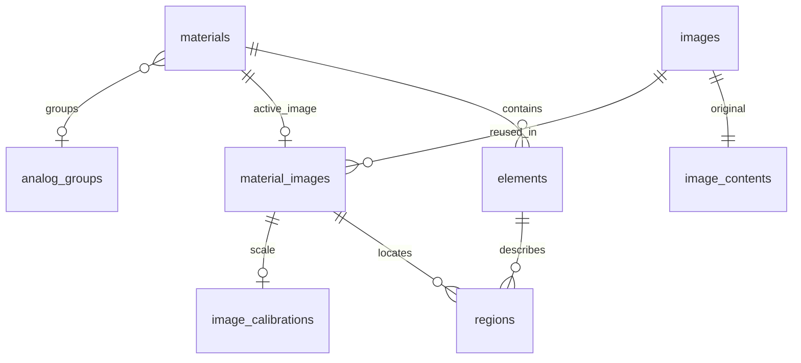

# Модель данных HISTOSETS — схема 7 (update8)

Каталог `.histosets` — обычный файл SQLite с идентификатором приложения HISTOSETS и версией схемы 7. В нём находятся все постоянные сведения и исходные изображения. Один и тот же формат используется для рабочего каталога, резервной копии и экспорта выбранных карточек. Формат геометрии внутри базы не изменился.

Доступ к базе реализован в `HistOSets.Storage` независимо от WPF. Файлы [миграций](../src/HistOSets.Storage/Migrations) создают и обновляют структуру. Переход к одному файлу выполняет [`007_single_file_catalog.sql`](../src/HistOSets.Storage/Migrations/007_single_file_catalog.sql) вместе с кодом преобразования. Проекция просмотра `AtlasCatalog` не загружает байты изображений заранее.

## Таблицы

| Таблица | Что хранит |
|---|---|
| `catalog_metadata`, `schema_migrations` | UUID и имя каталога, ревизия содержимого, время создания и изменения, версия формата и журнал миграций. `format_version = 7`, как и `user_version` SQLite. Открытие, чтение и поиск не меняют ревизию. |
| `materials` | Карточка объекта: препарат, анатомический снимок, рентгенограмма, схема. Статус `draft` или `ready`, авторство, права, необязательная ссылка на группу аналогов. |
| `material_translations` | Название, краткое и полное описание на определённом языке. Одна запись на пару материал–язык. |
| `analog_groups`, `analog_group_translations` | Группы аналогов и их названия. Материал входит не более чем в одну группу. Объекты группы имеют собственные изображения, области и UUID и могут использовать общее название группы как ответ. |
| `images` | Метаданные неизменяемого оригинала: UUID, SHA-256, размеры в байтах и пикселях, DPI, MIME, ориентация и служебный `storage_key`. Ключ не используется для открытия внешнего файла в новом каталоге. |
| `image_contents` | Исходные байты изображения в `data BLOB`, одна запись на `image_id`. Отдельная таблица позволяет читать метаданные без больших двоичных полей. Её `rowid` используется SQLite для чтения и записи BLOB частями. |
| `material_images` | Связь карточки и изображения. Частичный уникальный индекс разрешает только одну активную связь (`deleted_utc IS NULL`) на карточку. Черновик может не иметь изображения. Один оригинал можно использовать в нескольких карточках. |
| `image_calibrations` | Физический масштаб `pixel_size_x_m`, `pixel_size_y_m` в метрах на пиксель; способ и пояснение, исходная ширина, высота и единица ввода. Одна активная калибровка на связь карточки с изображением. |
| `elements`, `element_translations` | Элемент карточки и его название, краткое и полное описание на каждом языке. Перевод не дублирует геометрию. |
| `regions` | Одна область элемента; связь с конкретным изображением, `geometry_type`, `geometry_json`. Составные внешние ключи не дают связать элемент и изображение разных карточек. |
| `tag_groups`, `tag_group_translations` | Типы тегов. Активны шесть системных кодов: `author`, `organization`, `subject`, `topic`, `purpose`, `other`. Это Автор, Организация, Предметная область, Тема, Назначение, Прочее. |
| `tags`, `tag_translations`, `material_tags` | Значения тегов, их переводы и назначения карточкам. |
| `training_prompts`, `training_prompt_translations` | Учебные описания карточек или элементов: несколько вариантов, порядок, признак использования и переводы. Сессии и ответы обучающихся не входят в файл. |
| `exchange_baselines` | Последнее принятое содержимое источника и подтверждённое локальное состояние сущности. Используется при сравнении изменений и конфликтах. |
| `exchange_origin` | Необязательная запись о каталоге, из которого экспортирована подборка: UUID, имя, ревизия источника и время экспорта. |
| `import_batches` | Пустая служебная таблица для совместимости внешних ключей прежней схемы. В новом документе нет прежних ZIP-манифестов, XML и ссылок на его файлы. |

У сущностей и связей есть свои UUID, ревизии и время изменения. `deleted_utc` помечает удалённые записи; они не показываются пользователю, но сохраняются в полной копии и могут передаваться явно. `origin_catalog_id` хранит происхождение сущности, а старые `source_batch_id` очищаются при преобразовании. Имена карточек и аналогов не служат идентификаторами. `revision` защищает от записи поверх более свежей правки; при объединении сверяется также содержимое, поскольку независимые сохранения могут иметь одну ревизию.



Диаграмма показывает рабочие связи. У карточки могут оставаться неактивные связи из её истории. Поля `is_primary` и `sort_order` прежней таблицы связей сохранены; активная связь единственная и отмечена основной.

## Редактирование и готовность

`MaterialDraft` — рабочая копия в памяти. Изменения текстов, тегов, изображения, калибровки, элементов и областей попадают в каталог при сохранении транзакцией. Сохранение нового изображения записывает оригинальные байты вместе с метаданными. Повторное применение того же оригинала определяется по SHA-256; это сохраняет разметку и калибровку. При замене другим оригиналом нельзя переносить старые контуры на новые пиксели автоматически.

Для `ready` требуются доступное изображение, название и оба описания карточки и каждого её элемента на RU/EN, а также переводы назначенных тегов, их типов и группы аналогов. Учебные описания необязательны для готовности карточки; для каждого метода самопроверки свои проверки пригодности. Черновик может хранить неполные тексты и не иметь изображения. Просмотр показывает карточки с изображением, редактор — и черновики без него.

Калибровка относится к текущему оригиналу и участвует в сохранении рабочей копии. DPI — метаданные снимка, которые сами по себе не задают физический размер биологического объекта. Без калибровки измерения отображаются в пикселях. Измерения вычисляются из геометрии и масштаба при показе, отдельной таблицы площадей и периметров нет.

## Геометрия

Для каждой области хранится отдельный JSON внутри `regions.geometry_json`. Координаты относятся к пикселям исходного изображения. Для прямоугольника и эллипса задаются границы; для полигона — упорядоченные точки. Замыкающую сторону не нужно указывать повторно. Нетронутый эллипс остаётся параметрической фигурой.

```json
{"version":1,"kind":"ellipse","coordinateSpace":"pixels","x":120.5,"y":80,"width":60,"height":35}
```

Составная область (`compound`) хранит набор колец и правило `evenOdd`. Оно позволяет представить внешние контуры, отверстия, острова в отверстиях и раздельные фрагменты в одной области. Кисть и ластик меняют итоговую геометрию, поэтому для повторного открытия не нужно воспроизводить последовательность штрихов. Просмотр и измерение не преобразуют сохранённые фигуры.

```json
{"version":2,"kind":"compound","coordinateSpace":"pixels","fillRule":"evenOdd","rings":[[[0,0],[100,0],[100,100],[0,100]],[[30,30],[70,30],[70,70],[30,70]]]}
```

`RegionGeometryCodec` проверяет версию, тип, систему координат и структуру JSON; числовые значения должны быть конечными. Прямоугольник и эллипс требуют положительного размера, полигон — не менее трёх различных вершин. Тип JSON должен совпадать с `regions.geometry_type`. Области рассчитываются без округления до экранных пикселей. Округление площади вверх до сотых применяется только при отображении. Периметр включает границы отверстий.

## Оригиналы, копии и обмен

При добавлении оригинала сохраняются исходные байты и SHA-256. Потоки читаются по мере открытия нужного снимка, без чтения всего каталога в память. Оригиналы переиспользуются по SHA-256. В этой версии предельный размер одного оригинала — 900 000 000 байт; это ограничение файла, а не гарантия декодирования изображения любых размеров. Пирамиды сверхбольших сканов разрабатываются отдельно после получения рабочего материала.

Полная копия создаётся через механизм SQLite, проверяется и записывается в новый `.histosets`. Программа не перезаписывает существующий файл копии. Автоматическая копия перед изменяющим объединением сохраняется в `BACKUPS` рядом с каталогом. Отправлять копию можно отдельно от настроек, журналов и приложения.

При экспорте выбранных карточек создаётся новый каталог с собственным UUID. Объекты в нём сохраняют UUID, геометрию, учебные описания и связанные справочники; группы аналогов идут вместе со связанными карточками без автоматического добавления остальных членов. Пока полученный каталог не редактировали, `exchange_origin` позволяет сопоставлять его со сведениями отправителя. После собственных изменений каталог участвует в обмене как самостоятельный источник. Входящий файл проверяется и сравнивается с локальным до изменений; при записи конфликтные карточки принимаются по выбранным решениям. Полная копия сохраняет и журнал сравнения, экспорт подборки его не переносит.

## Переход на схему 7

Исходник для переноса — папка с прежней SQLite и оригиналами или старый резервный `.histosets` с ZIP внутри. Код открывает схему 1–6, обновляет копию до схемы 7, проверяет хеши и переносит оригиналы в `image_contents`. Старый архив временно читается для извлечения базы и изображений; исходные XML в переносе не участвуют. Готовый `.histosets` публикуется только после успешной проверки; предыдущий каталог не меняется.

У прежней карточки с несколькими изображениями UUID остаётся у одной карточки с её главным изображением. Для остальных снимков создаются новые карточки, а их прежние связи и области перемещаются к новым владельцам; масштаб остаётся связан с тем же изображением. Общие тексты, элементы, теги и учебные описания копируются. Исходная группа аналогов сохраняется либо создаётся общая для разделённых карточек. Тип «Гистология» переносится в «Предметная область», другие нестандартные типы — в «Прочее»; значения и назначения сохраняются. Подробности перехода описаны в [инструкции update8](update8.md).

Старые файлы `.histosets-exchange` не являются каталогами схемы 7. Их применяют в 0.7.3, а затем переносят получившийся каталог. Для ещё не импортированного XML используется тот же порядок: импорт в 0.7.3, затем перенос.

## Совместимость с будущей веб-версией

Настольное хранилище SQLite и предполагаемая PostgreSQL имеют общую логическую модель: единицы данных, связи, правила UUID и калибровки. Физическая реализация может отличаться: например, байты изображений в веб-версии могут храниться в объектном хранилище. В приложении идентификаторы записываются как канонический `TEXT` с UUID, даты как UTC ISO 8601, координаты и размеры калибровки как `REAL`, счётчики и размеры файла как `INTEGER`. PostgreSQL допускает соответствующие `uuid`, `timestamptz`, `double precision` и `bigint`. Настольный каталог сохраняет SQL-схему, версии и близкие к данным ограничения; серверная реализация пока не входит в update8.
